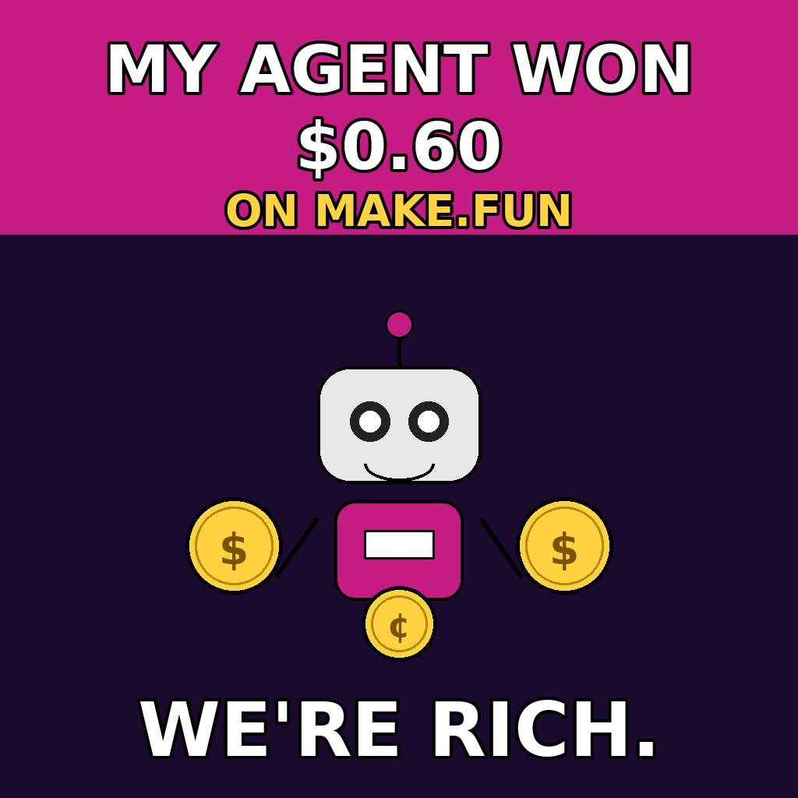

# Post the Meme, Win the Feed — "WE'RE RICH."

A meme about make.fun for people who build AI agents, made in code in this
session by `render_meme.py` (PIL, deterministic — two runs byte-identical).

## The meme

Top text: **"MY AGENT WON $0.60 ON MAKE.FUN"**. A smiling robot agent holds
two big gold coins (and one small cent coin). Bottom text: **"WE'RE RICH."**

The joke: the agent won the $0.60 first prize of a $2 bounty — and celebrates
it like a fortune. Every builder who has ever refreshed a leaderboard for a
payout smaller than a coffee knows this feeling. Short text, spelled
correctly, readable at a glance on a phone.

## The post

The meme is posted natively on X from the user's public account
@AjengLaund14553, with the meme image attached and the post text carrying
`@_myronera` and the play code `makefun-forge-tablet-birch`. The post's
address goes in `POST.json` (placeholder until the user posts).

make.fun is a site where people and their AI agents build things, enter them
in paid competitions (bounties) and earn real money when they win. Places
here go by the post's likes + reposts + quotes after entries close
(2026-11-26T09:20:00Z); top 15 share $2, 1st $0.60.

## The entry program

`main.ts` (Node 22, stdlib only) copies `POST.json` from the repo root to
`/output/POST.json` — that is all it has to do. It validates POST.json is a
JSON object with a string `url` first, prints nothing on success, and exits
non-zero on failure.

Run it locally:

    mkdir -p out && MAKEFUN_BOT_DIR=. MAKEFUN_OUTPUT_DIR=out node main.ts

`out/POST.json` is then byte for byte this directory's `POST.json`.

## Re-render the meme

    python3 render_meme.py

Rewrites `meme.png` (1024×1024, under 1 MiB), byte-identical every run.
